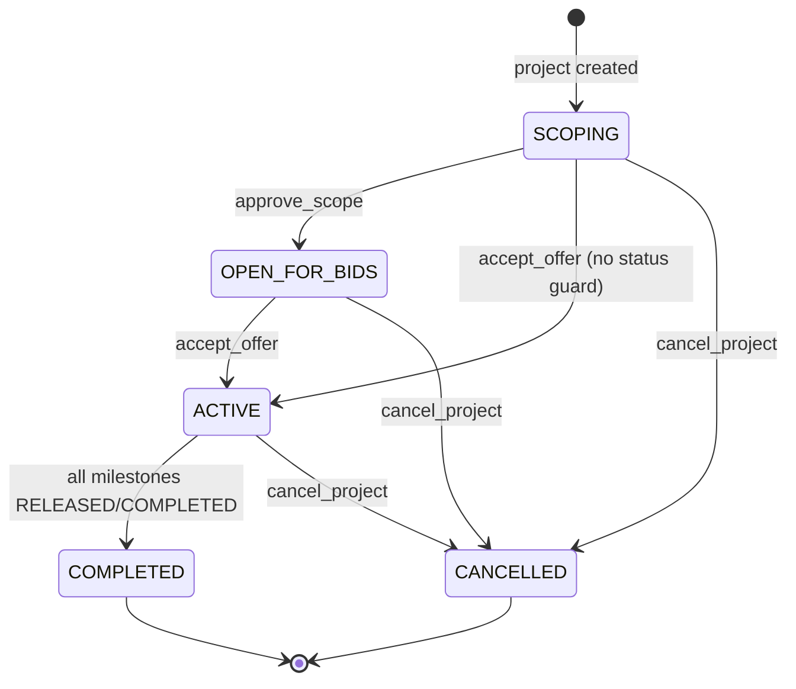

# Idea Launch — Technical Specification

> **Document provenance:** No file named **"Idea Launch Project"** exists in this workspace (searched `/home/node`, `/workspaces/idea-launch`, and the wider filesystem, including all non-`node_modules` Markdown/text files). This specification is therefore reconstructed **verbatim from the actual implementation** in this repository: `package.json` files, `backend/src/*.ts`, `backend/prisma/schema.prisma`, `backend/prisma/seed.ts`, and `frontend/src/**`. Items that are proposed rather than implemented are explicitly marked **[PROPOSED]**.

---

## 1. Overview

Idea Launch is a two-sided marketplace MVP for scoping, funding, and delivering software projects:

- **Clients** describe an idea, receive an AI-generated scope blueprint, approve it, and fund milestone-based escrow.
- **Builders** onboard (GitHub + ecosystems + portfolio), submit offers, deliver staged demos, and receive escrow releases.
- Delivery is governed by four fixed stages, late penalties, progressive refunds, extensions, and post-project quality ratings.
- All project interaction happens in a realtime chat room powered by Socket.io, with rich "widget" messages (scope, offer, demo) rendered inline.

**Current maturity:** functional end-to-end demo with seeded data and mock AI scoping. No database migrations, REST CRUD API, automated tests, or real payment/LLM integrations yet.

---

## 2. Repository Layout

```
idea-launch/
├── package.json                 # npm workspaces root; concurrently dev script
├── package-lock.json
├── skills-lock.json
├── .gitignore                   # ignores node_modules, dist, .env*
├── .devcontainer/
│   ├── Dockerfile
│   └── devcontainer.json        # forwards 5173, 49374; postCreate: npm install
├── .opencode/
│   ├── agents/frontend-developer.md
│   └── skills/                  # 27 reusable engineering skills
├── backend/
│   ├── package.json
│   ├── tsconfig.json
│   ├── .env                     # DATABASE_URL, DIRECT_URL, AUTH_SECRET, PORT, CLIENT_ORIGIN
│   ├── prisma/
│   │   ├── schema.prisma        # PostgreSQL schema
│   │   └── seed.ts              # demo users, project-123, 4 milestones
│   ├── src/
│   │   ├── index.ts             # Express app, Auth.js, HTTP server bootstrap
│   │   └── socket.ts            # all Socket.io event handlers
│   └── dist/                    # compiled JS (present)
└── frontend/
    ├── package.json
    ├── vite.config.ts           # React + Tailwind plugins, "@" → ./src
    ├── components.json          # shadcn config (radix-nova, neutral, lucide)
    ├── tsconfig*.json
    ├── .oxlintrc.json
    ├── public/
    ├── src/
    │   ├── main.tsx
    │   ├── App.tsx              # role switcher + onboarding gate
    │   ├── App.css
    │   ├── index.css            # Tailwind v4 theme, Geist font, light/dark tokens
    │   ├── components/
    │   │   ├── Chat.tsx
    │   │   ├── BuilderOnboarding.tsx
    │   │   ├── ScopeWidget.tsx
    │   │   ├── OfferWidget.tsx
    │   │   ├── DemoWidget.tsx
    │   │   ├── ProjectControls.tsx
    │   │   └── ui/              # badge, button, card, checkbox, input
    │   └── lib/utils.ts         # cn() helper
    └── dist/                    # production build (present)
```

**Workspace model:** npm workspaces (`frontend`, `backend`). Root `npm run dev` runs both dev servers via `concurrently`.

---

## 3. Technology Stack

### 3.1 Root

| Item | Version / Value |
|---|---|
| Package manager | npm workspaces |
| Node dev orchestration | `concurrently ^10.0.7` |
| Scripts | `dev` (backend + frontend), `build` (all workspaces), `test` (placeholder, exits 1) |
| Module type | `commonjs` at root |

### 3.2 Backend

| Category | Package | Version |
|---|---|---|
| Runtime | Node.js | (devcontainer image) |
| Language | TypeScript | `^7.0.2` |
| Dev runner | `tsx` | `^4.21.0` |
| Web framework | `express` | `^5.3.0` |
| Realtime | `socket.io` | `^4.8.4` |
| ORM | `@prisma/client` / `prisma` | `6.19.3` |
| Database | PostgreSQL | via `DATABASE_URL` + `DIRECT_URL` |
| Auth | `@auth/express` | `^0.12.3` |
| Auth adapter | `@auth/prisma-adapter` | `^2.11.3` |
| CORS | `cors` | `^2.8.5` |
| Env loading | `dotenv` | `^17.2.3` |
| Types | `@types/node`, `@types/express`, `@types/cors` | `^24.19.2`, `^5.0.6`, `^2.8.19` |

**Backend scripts:** `dev` (`tsx watch src/index.ts`), `build` (`tsc`), `start` (`node dist/index.js`), `prisma:generate`, `prisma:migrate` (`prisma migrate dev`), `prisma:studio`, `seed` (`tsx prisma/seed.ts`).

**Compiler:** `target ES2023`, `module NodeNext`, `strict`, `rootDir src`, `outDir dist`, source maps.

### 3.3 Frontend

| Category | Package | Version |
|---|---|---|
| UI library | `react`, `react-dom` | `^19.3.1` |
| Build tool | `vite` | `^8.3.6` |
| React plugin | `@vitejs/plugin-react` | `^6.1.2` |
| Language | TypeScript | `~7.0.2` |
| Styling | `tailwindcss` + `@tailwindcss/vite` | `^4.3.5` |
| Components | shadcn (`^4.23.0`), `radix-ui ^1.8.1` | |
| Variants | `class-variance-authority` | `^0.7.1` |
| Icons | `lucide-react` | `^1.70.0` |
| Realtime client | `socket.io-client` | `^4.8.4` |
| Fonts | `@fontsource-variable/geist` | `^5.3.0` |
| Animation | `tw-animate-css` | `^1.4.0` |
| Lint | `oxlint` | `^1.90.0` |

**Frontend scripts:** `dev` (`vite`), `build` (`tsc -b && vite build`), `lint` (`oxlint`), `preview` (`vite preview`).

**TypeScript:** bundler resolution, `jsx: react-jsx`, path alias `@/* → ./src/*`, `noUnusedLocals/Parameters`, `noEmit`.

---

## 4. System Architecture

```
┌─────────────────────────────┐         ┌─────────────────────────────┐
│  React 19 SPA (Vite)        │         │  Node.js + Express 5        │
│  localhost:5173             │         │  localhost:3001             │
│                             │  HTTP   │                             │
│  App.tsx (role switch)      │ ──────► │  GET /health                │
│  Chat.tsx                   │         │  /auth/*  (Auth.js)         │
│  Widgets / Controls         │         │                             │
│                             │ Socket  │  Socket.io server           │
│  socket.io-client           │ ◄─────► │  src/socket.ts              │
└─────────────────────────────┘         └──────────────┬──────────────┘
                                                       │ Prisma
                                                       ▼
                                            ┌─────────────────────┐
                                            │  PostgreSQL         │
                                            │  User, Project,     │
                                            │  Milestone, Message │
                                            └─────────────────────┘
```

- The HTTP layer is intentionally minimal: health check and Auth.js endpoints only.
- **All business mutations occur over Socket.io** (not REST).
- CORS is restricted to `CLIENT_ORIGIN` (default `http://localhost:5173`) with credentials enabled, for both HTTP and Socket.io.
- Two `PrismaClient` instances exist (one in `index.ts`, one in `socket.ts`); functionally fine for the MVP but worth consolidating.

### 4.1 Runtime bootstrap (`backend/src/index.ts`)

1. Load `.env` via `dotenv/config`.
2. Instantiate `PrismaClient`.
3. Configure `ExpressAuth` with:
   - `PrismaAdapter(prisma)`
   - `secret: AUTH_SECRET`, `trustHost: true`
   - `session.strategy = "jwt"`
   - One **Credentials** provider (demo login).
4. Apply `cors({ origin: CLIENT_ORIGIN, credentials: true })` and `express.json()`.
5. Register `GET /health` → `{ status: "ok", uptime }`.
6. Mount `/auth` → `ExpressAuth(authConfig)`.
7. Create HTTP server, attach Socket.io via `initializeSocket(httpServer)`.
8. Listen on `PORT` (default `3001`).

### 4.2 Authentication (implemented)

| Aspect | Implementation |
|---|---|
| Provider | Credentials, single `username` field |
| Accepted usernames | `client` and `builder` only |
| Email mapping | `client` → `client@example.com`; `builder` → `builder@example.com` |
| User lookup | `prisma.user.findUnique({ where: { email } })`; rejects if absent |
| Returned user | `{ id, name, email, role }` |
| JWT callback | Copies `user.id` and `user.role` into token |
| Session callback | Copies `token.id` and `token.role` into `session.user` |
| Socket identity | `socket.handshake.auth.userId` (client-supplied, **not verified**) |

> **Security note:** Socket.io does not validate the Auth.js session/JWT; any client can claim any `userId`. The frontend does not currently perform an Auth.js login at all — it uses hardcoded demo identities. Production must verify the session before accepting socket events.

---

## 5. Data Model (Prisma / PostgreSQL)

**Datasource:** PostgreSQL via `DATABASE_URL`, with `DIRECT_URL` for direct connections (Supabase-compatible).
**Generator:** `prisma-client-js`.
**Money convention:** all monetary fields are `Int` **cents** (e.g. `25000` = `$250.00`). UI divides by 100 for display.

### 5.1 `User`

| Field | Type | Attributes |
|---|---|---|
| `id` | String | `@id @default(cuid())` |
| `role` | String | `@default("CLIENT")` — values used: `CLIENT`, `BUILDER` |
| `ecosystems` | String | `@default("")` — comma-separated list |
| `portfolioUrls` | String | `@default("")` — comma-separated list |
| `probationary` | Boolean | `@default(true)` |
| `rulesAccepted` | Boolean | `@default(false)` |
| `name` | String? | |
| `email` | String? | `@unique` |
| `emailVerified` | DateTime? | Auth.js field |
| `image` | String? | |
| `accounts` | Account[] | |
| `sessions` | Session[] | |
| `clientProjects` | Project[] | relation `"ClientProjects"` |
| `builderProjects` | Project[] | relation `"BuilderProjects"` |
| `sentMessages` | Message[] | relation `"SentMessages"` |
| `createdAt` | DateTime | `@default(now())` |
| `updatedAt` | DateTime | `@updatedAt` |

### 5.2 `Account` (Auth.js)

| Field | Type | Attributes |
|---|---|---|
| `id` | String | `@id @default(cuid())` |
| `userId` | String | FK → `User.id`, `onDelete: Cascade` |
| `type` | String | |
| `provider` | String | |
| `providerAccountId` | String | |
| `refresh_token`, `access_token` | String? | |
| `expires_at` | Int? | |
| `token_type`, `scope`, `id_token`, `session_state` | String? | |

Constraint: `@@unique([provider, providerAccountId])`.

### 5.3 `Session` (Auth.js)

| Field | Type | Attributes |
|---|---|---|
| `id` | String | `@id @default(cuid())` |
| `sessionToken` | String | `@unique` |
| `userId` | String | FK → `User.id`, `onDelete: Cascade` |
| `expires` | DateTime | |

### 5.4 `VerificationToken` (Auth.js)

| Field | Type | Attributes |
|---|---|---|
| `identifier` | String | |
| `token` | String | `@unique` |
| `expires` | DateTime | |

Constraint: `@@unique([identifier, token])`.

### 5.5 `Project`

| Field | Type | Attributes |
|---|---|---|
| `id` | String | `@id @default(cuid())` |
| `title` | String | |
| `totalEscrow` | Int | `@default(0)` — cents |
| `status` | ProjectStatus | `@default(SCOPING)` |
| `clientId` | String | FK → `User.id`, `onDelete: Cascade` |
| `builderId` | String? | FK → `User.id`, `onDelete: SetNull` |
| `deadline` | DateTime? | |
| `extensionRequested` | Boolean | `@default(false)` |
| `extensionGranted` | Boolean | `@default(false)` |
| `cancelledAt` | DateTime? | |
| `refundPercent` | Int? | |
| `refundAmount` | Int? | cents |
| `qualityScore` | Int? | 1–5 |
| `qualityFeedback` | String? | |
| `latePenaltyTotal` | Int | `@default(0)` — cents |
| `milestones` | Milestone[] | |
| `messages` | Message[] | |
| `createdAt` / `updatedAt` | DateTime | `now()` / `@updatedAt` |

### 5.6 `Milestone`

| Field | Type | Attributes |
|---|---|---|
| `id` | String | `@id @default(cuid())` |
| `projectId` | String | FK → `Project.id`, `onDelete: Cascade` |
| `stageNumber` | Int | 1–4 |
| `title` | String | |
| `amount` | Int | cents |
| `releasePercent` | Int | `@default(0)` |
| `status` | MilestoneStatus | `@default(PLANNED)` |
| `dueDate` | DateTime? | |
| `releasedAt` | DateTime? | |
| `latePenalty` | Int | `@default(0)` — cents |
| `demoUrl` | String? | |
| `createdAt` / `updatedAt` | DateTime | `now()` / `@updatedAt` |

### 5.7 `Message`

| Field | Type | Attributes |
|---|---|---|
| `id` | String | `@id @default(cuid())` |
| `projectId` | String | FK → `Project.id`, `onDelete: Cascade` |
| `senderId` | String? | FK → `User.id`, `onDelete: SetNull` |
| `type` | MessageType | `@default(TEXT)` |
| `content` | String | |
| `payload` | Json? | widget-specific data |
| `createdAt` | DateTime | `@default(now())` |

### 5.8 Enums

```prisma
enum ProjectStatus {
  SCOPING
  OPEN_FOR_BIDS
  ACTIVE
  COMPLETED
  CANCELLED
}

enum MilestoneStatus {
  PLANNED
  IN_PROGRESS
  RELEASED
  COMPLETED
  BLOCKED
}

enum MessageType {
  TEXT
  WIDGET
  DEMO_WIDGET
  SCOPE_WIDGET
  SYSTEM
}
```

### 5.9 Seed data (`backend/prisma/seed.ts`)

Deletes in dependency order: messages → milestones → projects → sessions → accounts → users, then creates:

- **Client:** `id: "client-user"`, `name: "Client User"`, `email: "client@example.com"`, `role: "CLIENT"`.
- **Builder:** `id: "builder-user"`, `name: "Builder User"`, `email: "builder@example.com"`, `role: "BUILDER"`.
- **Project:** `id: "project-123"`, `title: "Project 123"`, `totalEscrow: 100000` (`$1,000.00`), `status: "SCOPING"`, deadline `now + 14 days`, client + builder assigned.
- **Milestones:**

| id | Stage | Title | Amount | releasePercent | Status |
|---|---|---|---|---|---|
| `milestone-1` | 1 | Agreement | 25000 | 0 | PLANNED |
| `milestone-2` | 2 | Initial Demo | 25000 | 30 | PLANNED |
| `milestone-3` | 3 | Final Demo | 25000 | 40 | PLANNED |
| `milestone-4` | 4 | Deployment | 25000 | 30 | PLANNED |

> **No migrations exist.** `backend/prisma/` contains only `schema.prisma` and `seed.ts`; a `prisma migrate dev`/`db push` is required before seeding.

---

## 6. Backend API Surface

### 6.1 HTTP

| Method | Path | Auth | Response |
|---|---|---|---|
| GET | `/health` | Public | `{ "status": "ok", "uptime": <seconds> }` |
| * | `/auth/*` | Auth.js | Standard Auth.js endpoints (sign-in, session, callbacks, etc.) |

No project/milestone/message REST endpoints exist; those operations are Socket.io-only.

### 6.2 Socket.io Connection

- CORS origin: `CLIENT_ORIGIN` (default `http://localhost:5173`), credentials enabled.
- On connect: `socket.data.userId = socket.handshake.auth?.userId ?? null`.
- Client may send `auth: { userId, role, name }`; only `userId` is stored.
- Logs connection and disconnection with reason.

**Room model:** one Socket.io room per `projectId`. Clients join via `join_project`; all subsequent project events are broadcast with `io.to(projectId).emit(...)`.

**Ack convention:** mutating handlers accept an optional callback `ack({ ok, ... })`. On failure: `{ ok: false, error: "<message>" }`.

---

## 7. Socket.io Event Flow

### 7.1 Event Summary

| Event | Direction | Required payload | Ack | Side effects | Broadcasts |
|---|---|---|---|---|---|
| `join_project` | C→S | `{ projectId, userId? }` | — | Joins room; loads project + milestones | `project_updated` (to caller) |
| `send_message` | C→S | `{ projectId, content, senderId?, type?, payload? }` | `{ ok, message }` | Inserts `Message`; special-cases scope trigger | `new_message` (room) |
| `submit_demo` | C→S | `{ projectId, milestoneId, demoUrl?, senderId?, payload? }` | `{ ok, message, latePenalty }` | Applies late penalty; sets `demoUrl`, status `IN_PROGRESS`; inserts `DEMO_WIDGET` | `new_message`, `milestone_updated` |
| `approve_milestone` | C→S | `{ milestoneId }` | `{ ok, milestone }` | Sets `RELEASED` + `releasedAt`; may complete project | `milestone_updated`, possibly `project_updated` |
| `approve_scope` | C→S | `{ projectId, userId? }` | `{ ok, project }` | Sets `OPEN_FOR_BIDS`; inserts `SYSTEM` message | `project_updated`, `new_message` |
| `submit_onboarding` | C→S | `{ userId, ecosystems[], portfolioUrls[], rulesAccepted }` | `{ ok, user }` | Updates builder profile; clears `probationary` | — |
| `accept_offer` | C→S | `{ projectId }` | `{ ok, project }` | Sets `ACTIVE` | `project_updated` |
| `cancel_project` | C→S | `{ projectId, userId? }` | `{ ok, project, refundPercent, refundAmount }` | Computes refund tier; sets `CANCELLED`, `cancelledAt`, refund fields; inserts `SYSTEM` message | `project_updated`, `new_message` |
| `request_extension` | C→S | `{ projectId, userId? }` | `{ ok, project }` | Adds 48h to deadline (or now); sets `extensionRequested` | `project_updated` |
| `submit_rating` | C→S | `{ projectId, rating 1–5, feedback?, userId? }` | `{ ok, project }` | Validates completed/cancelled; stores score/feedback; inserts `SYSTEM` message | `project_updated`, `new_message` |
| `new_message` | S→C | Message record incl. sender | — | — | room |
| `project_updated` | S→C | `{ project }` incl. milestones | — | — | room (or caller) |
| `milestone_updated` | S→C | `{ milestone }` | — | — | room |

### 7.2 Project State Machine



> `accept_offer` does **not** check current status, so it can activate a project directly from `SCOPING` or `OPEN_FOR_BIDS`; it also does not set `totalEscrow` or milestone amounts. Escrow "funding" is currently a status transition only.

### 7.3 Primary Happy Path (sequence)

```mermaid
sequenceDiagram
    actor Client
    actor Builder
    participant UI as React SPA
    participant S as Socket.io Server
    participant DB as PostgreSQL (Prisma)

    Client->>UI: "Simulate AI Intake"
    UI->>S: send_message [TRIGGER_SCOPE_GENERATION]
    S->>DB: create SCOPE_WIDGET message (hardcoded blueprint)
    S-->>UI: new_message (room)
    Client->>UI: Approve Blueprint
    UI->>S: approve_scope
    S->>DB: Project → OPEN_FOR_BIDS + SYSTEM message
    S-->>UI: project_updated, new_message

    Builder->>UI: Generate Final Offer
    UI->>S: send_message (WIDGET payload milestones)
    S->>DB: create WIDGET message
    S-->>UI: new_message

    Client->>UI: Accept & Fund Escrow
    UI->>S: accept_offer
    S->>DB: Project → ACTIVE
    S-->>UI: project_updated

    Builder->>UI: Submit Next Demo
    UI->>S: submit_demo (milestoneId, demoUrl)
    S->>DB: penalty if late; milestone IN_PROGRESS; DEMO_WIDGET
    S-->>UI: new_message, milestone_updated

    Client->>UI: Approve Milestone
    UI->>S: approve_milestone
    S->>DB: milestone RELEASED/releasedAt
    S-->>UI: milestone_updated
    Note over S,DB: When all milestones released → Project COMPLETED
```

### 7.4 Handler Details

#### `join_project`
- Ignores payload without `projectId`.
- Joins the Socket.io room named `projectId`.
- Fetches project with `milestones`; if found, emits `project_updated` **only to the joining socket**.
- Does not fetch message history; chat history is not replayed on join (messages are in-memory on the client).

#### `send_message`
- Requires `projectId` and `content`; otherwise ack error.
- **Scope trigger:** if `content` contains the sentinel `[TRIGGER_SCOPE_GENERATION]`, creates a `SCOPE_WIDGET` message with a hardcoded blueprint payload (see §8) and returns.
- Otherwise creates a message with `type = data.type ?? "TEXT"` and optional JSON `payload`, including sender `{ id, name, image }`.
- Broadcasts `new_message` to the project room.

#### `submit_demo`
- Requires `projectId` and `milestoneId`.
- Loads milestone; computes late penalty:
  `latePenalty = milestone.dueDate && now > dueDate ? Math.round(milestone.amount * 0.05) : 0`
- If penalty > 0: sets milestone `latePenalty` and increments `project.latePenaltyTotal`.
- Updates milestone `demoUrl` and status `IN_PROGRESS`.
- Creates `DEMO_WIDGET` message with `{ milestoneId, demoUrl, latePenalty, ...data.payload }`.
- Emits `new_message`, then re-reads and emits `milestone_updated`.

#### `approve_milestone`
- Requires `milestoneId`.
- Sets status `RELEASED` and `releasedAt = now`.
- Loads all project milestones; if **every** milestone is `RELEASED` or `COMPLETED`, sets project `COMPLETED` and emits `project_updated`.
- Emits `milestone_updated`.
- Note: no authorization check that the caller is the project's client.

#### `approve_scope`
- Requires `projectId`.
- Sets project `OPEN_FOR_BIDS` (includes milestones).
- Creates `SYSTEM` message: `"Scope approved. Project is now open for bids."`
- Emits `project_updated` + `new_message`.

#### `submit_onboarding`
- Requires `userId`.
- Arrays are joined into comma-separated strings (`ecosystems`, `portfolioUrls`).
- Updates `ecosystems`, `portfolioUrls`, `rulesAccepted`, and sets `probationary: false`.
- No GitHub verification is stored despite the UI button.

#### `accept_offer`
- Requires `projectId`; sets status `ACTIVE`; returns project with milestones.
- Emits `project_updated`. No escrow amount validation or payment simulation.

#### `cancel_project`
- Requires `projectId`; loads project + milestones.
- Computes `maxReleasedStage` = highest `stageNumber` among `RELEASED`/`COMPLETED` milestones (0 if none).
- Refund tiers:
  - `maxReleasedStage >= 3` → **60%**
  - `maxReleasedStage >= 2` → **90%**
  - otherwise → **100%**
- `refundAmount = round(totalEscrow × refundPercent / 100)`.
- Sets `CANCELLED`, `cancelledAt`, `refundPercent`, `refundAmount`; creates `SYSTEM` message:
  `"Project cancelled. {refundPercent}% refund issued."`
- Emits `project_updated` + `new_message`.

#### `request_extension`
- Requires `projectId`.
- New deadline = `(project.deadline ?? now) + 48 hours`.
- Sets `extensionRequested: true` (and overwrites `deadline`).
- Emits `project_updated`.
- `extensionGranted` exists in schema but is never set; there is no client approval step.

#### `submit_rating`
- Requires `projectId`; rating must be an integer `1..5`.
- Only allowed when project status is `COMPLETED` or `CANCELLED`.
- Stores `qualityScore` and optional `qualityFeedback`; creates `SYSTEM` message:
  `"Quality rating submitted: {rating}/5."`
- Emits `project_updated` + `new_message`.
- Any connected user can rate; no check that the caller is the client.

---

## 8. AI Scoping Agent

### 8.1 Current implementation (mock)

There is **no LLM call, SDK, API key, or prompt file** in the repository. Scoping is simulated deterministically on the server.

**Trigger contract:**

- Client UI button **"Simulate AI Intake"** sends a normal text message whose content is exactly:
  ```
  [TRIGGER_SCOPE_GENERATION]
  ```
- Server detects the substring in `send_message` and, instead of persisting a `TEXT` message, creates a `SCOPE_WIDGET` message with the hardcoded blueprint below.

**Hardcoded blueprint payload (`socket.ts`):**

```json
{
  "title": "Project Scope Blueprint",
  "executiveSummary": "A scoped delivery plan for the idea, covering architecture, features, and milestones.",
  "technicalArchitecture": "React frontend, Node.js/Express backend, PostgreSQL via Prisma, Socket.io realtime.",
  "coreFeatures": [
    "AI-assisted scoping",
    "Milestone-based escrow",
    "Realtime chat and demos",
    "Quality scoring"
  ],
  "milestones": [
    { "title": "Agreement", "amount": 25000 },
    { "title": "Initial Demo", "amount": 25000 },
    { "title": "Final Demo", "amount": 25000 },
    { "title": "Deployment", "amount": 25000 }
  ],
  "outOfScope": [
    "Native mobile apps",
    "Third-party billing integrations"
  ]
}
```

Amounts are cents: `$250.00` each, `$1,000.00` total.

**Message envelope written to the database:**

```ts
{
  projectId,
  senderId: data.senderId ?? socket.data.userId ?? null,
  type: "SCOPE_WIDGET",
  content: "Project Scope Blueprint",
  payload: <blueprint above>
}
```

### 8.2 Client rendering

`ScopeWidget.tsx` renders, in order: title, Executive Summary, Technical Architecture, Core Features, Milestones (with `$amount/100`), Out of Scope. Clients see **Approve Blueprint** (emits `approve_scope`); builders see "Waiting for client approval."

### 8.3 AI scoping contract **[PROPOSED]**

To replace the mock with a real agent, preserve the existing UI contract and swap only the server-side generation:

- **Input:** client's free-text idea, optional constraints (budget, timeline, stack), and the project's current state.
- **Output:** JSON matching the `ScopePayload` interface below; validate with a schema before persisting.
- **Persistence:** create a `SCOPE_WIDGET` message exactly as today so the frontend needs no changes.
- **Failure mode:** ack `{ ok: false, error }` and post a `SYSTEM` message; do not create an empty blueprint.

**Suggested system prompt (proposed, not implemented):**

```text
You are the Idea Launch scoping agent. Convert a client's software idea into a
delivery blueprint for a milestone-based escrow marketplace.

Return ONLY valid JSON with this shape:
{
  "title": string,
  "executiveSummary": string,
  "technicalArchitecture": string,
  "coreFeatures": string[],
  "milestones": [{ "title": string, "amount": integer }],
  "outOfScope": string[]
}

Rules:
- Amounts are integer USD cents. The four milestone amounts MUST sum to the
  client's stated budget (or 100000 if no budget is given).
- Use exactly four milestones in this order: Agreement, Initial Demo,
  Final Demo, Deployment.
- Keep the architecture to the platform defaults (React, Node.js/Express,
  PostgreSQL/Prisma, Socket.io) unless the idea clearly requires otherwise.
- Be concrete and concise; no markdown, no commentary outside the JSON.
```

---

## 9. Frontend Specification

### 9.1 `App.tsx`

- Local state: `role` (`CLIENT` | `BUILDER`) and an in-memory `users` record.
- Hardcoded identities:
  - `CLIENT`: `id: "client-user"`, `name: "Client User"`, `probationary: false`, `rulesAccepted: true`
  - `BUILDER`: `id: "builder-user"`, `name: "Builder User"`, `probationary: true`, `rulesAccepted: false`
- Header: product title, role toggle buttons, and a `$1,500 Budget Cap` badge while the builder is probationary.
- If role is `BUILDER` and `rulesAccepted` is false → render `BuilderOnboarding`; otherwise render `Chat`.
- Onboarding completion flips the local builder flags (no session refetch).
- No Auth.js integration: the SPA never calls `/auth`.

### 9.2 `Chat.tsx`

- Constants: `PROJECT_ID = "project-123"`, `SOCKET_URL = "http://localhost:3001"`.
- Connects with `transports: ["websocket"]`, `auth: { userId, role, name }`.
- Emits `join_project` on mount; subscribes to `new_message`, `project_updated`, `milestone_updated`.
- Maintains `messages`, `draft`, `project`, `projectStatus`, `nextMilestoneIndex`.
- `milestone_updated` is rendered as a local `SYSTEM` message: `"Milestone <title|id> Approved - Escrow Released"`.
- Message rendering by type:
  - `WIDGET` → `OfferWidget`
  - `DEMO_WIDGET` → `DemoWidget`
  - `SCOPE_WIDGET` → `ScopeWidget`
  - `SYSTEM` → centered green status text
  - default → `"<sender name or id>: <content>"`
- Composer: Enter or Send emits `send_message` with `type: "TEXT"`.
- Client-only: **Simulate AI Intake** button.
- Builder-only:
  - Before `ACTIVE`: **Generate Final Offer** (disabled for probationary builders when `totalEscrow > 150000`, i.e. `$1,500`).
  - When `ACTIVE`: **Submit Next Demo**, which walks `milestone-1..4` in order via `nextMilestoneIndex` and sends mock URLs `https://demo.example.com/<milestoneId>`.
- Renders `ProjectControls` below the chat card.

### 9.3 `BuilderOnboarding.tsx`

- Separate socket connection; emits `submit_onboarding` with `{ userId, ecosystems[], portfolioUrls[], rulesAccepted }`.
- Validation before submit:
  - GitHub "connected" (local boolean toggle; no OAuth)
  - 1–2 ecosystems (comma-separated input)
  - Two non-empty portfolio URLs
  - Rules checkbox accepted
- Copy: acknowledges the **5% late penalty** and progressive escrow rules.
- On ack `{ ok: true }` calls `onComplete()`.

### 9.4 Widgets

| Component | Props | Behavior |
|---|---|---|
| `ScopeWidget` | `socket`, `projectId`, `role`, `payload` | Renders blueprint sections; client emits `approve_scope` |
| `OfferWidget` | `socket`, `projectId`, `role`, `projectStatus`, `milestones`, `total` | Lists milestones and total (cents → dollars); client emits `accept_offer`; shows "Project Funded" when `ACTIVE` |
| `DemoWidget` | `socket`, `milestoneId`, `demoUrl`, `role` | Shows milestone + demo link; client emits `approve_milestone` |
| `ProjectControls` | `socket`, `project`, `role`, `userId` | Status, released escrow %, deadline, late penalties, extension state, refund, quality rating; builder can `request_extension`; client can `cancel_project`; rating form when `COMPLETED`/`CANCELLED` and unrated |

### 9.5 UI system

- shadcn config: style `radix-nova`, base color `neutral`, CSS variables, lucide icons, no RSC.
- Tailwind v4 CSS-first config in `src/index.css`; Geist Variable font; light/dark tokens using OKLCH; `tw-animate-css`.
- Local primitives: `Badge`, `Button`, `Card`, `Checkbox`, `Input`; `cn()` helper in `src/lib/utils.ts`.

---

## 10. Configuration & Environment

### 10.1 Backend `.env` keys (values intentionally omitted)

| Key | Purpose |
|---|---|
| `DATABASE_URL` | PostgreSQL pooled connection (local Prisma Dev by default) |
| `DIRECT_URL` | Direct/non-pooled connection (Supabase-compatible) |
| `AUTH_SECRET` | Auth.js signing secret |
| `PORT` | API port, default `3001` |
| `CLIENT_ORIGIN` | Allowed CORS origin, default `http://localhost:5173` |

Commented Supabase placeholders exist for production URLs. **No `.env.example` is committed**, although `.gitignore` references `!.env.example`.

### 10.2 Frontend configuration

- `vite.config.ts`: `react()`, `tailwindcss()`, alias `@` → `./src`.
- Hardcoded API origin in components: `http://localhost:3001`.
- No Vite env variables are used (e.g. no `VITE_API_URL`).

### 10.3 Devcontainer

- Name: `Build It`; Dockerfile build; user `node`; 2 GB RAM / 2 CPUs.
- Forwards ports **5173** and **49374** — note that backend **3001** is not forwarded.
- `postCreateCommand`: `npm install --prefer-offline`.

### 10.4 Commands

```bash
# Install (workspace root)
npm install

# Run both apps
npm run dev            # concurrently: backend tsx watch + frontend vite

# Individual
npm run dev -w backend
npm run dev -w frontend

# Database
npm run prisma:generate -w backend
npm run prisma:migrate  -w backend   # creates migrations (none exist yet)
npm run seed            -w backend

# Build
npm run build           # both workspaces
npm run build -w backend
npm run build -w frontend

# Lint / preview
npm run lint -w frontend
npm run preview -w frontend
```

---

## 11. Business Rules Reference

| Rule | Implementation |
|---|---|
| Milestone stages | 4 fixed stages: Agreement, Initial Demo, Final Demo, Deployment |
| Escrow amounts | Integer cents; seed total `$1,000.00` |
| Release percentages | Seed: 0 / 30 / 40 / 30 |
| Late penalty | 5% of milestone amount, rounded, if submitted after `dueDate`; accumulated in `project.latePenaltyTotal` |
| Refund on cancel | Released stage ≥ 3 → 60%; ≥ 2 → 90%; else 100% |
| Probationary builder cap | `$1,500.00` (`150000` cents) enforced only in the frontend offer button |
| Extension | +48 hours, requested flag only; no approval flow |
| Quality rating | Integer 1–5 after `COMPLETED` or `CANCELLED`, one score per project |
| Scope approval | Moves project to `OPEN_FOR_BIDS` |
| Offer acceptance | Moves project to `ACTIVE`; no payment/escrow funding |
| Completion | Automatic when all milestones are `RELEASED`/`COMPLETED` |

---

## 12. Known Gaps, Risks, and Open Questions

1. **Missing source document:** the requested "Idea Launch Project" file does not exist; this spec is code-derived. If a canonical product brief exists elsewhere, it should be reconciled with this document.
2. **No migrations:** schema is not materialized via `prisma/migrations`; deployment must run `migrate`/`db push` and seed.
3. **No real auth in the SPA:** Auth.js is configured but unused by the frontend; sockets trust client-supplied `userId`, and no handler authorizes the caller's role or project membership.
4. **No payment/escrow integration:** "Accept & Fund Escrow" only changes status; `totalEscrow` and milestone amounts are never set by `accept_offer`.
5. **Mock AI only:** no LLM provider, prompt storage, schema validation, or retry/error UX; blueprint is static.
6. **Single hardcoded project:** `project-123` and `localhost:3001` are literals in the UI; no project list, creation, or routing.
7. **No message history:** `join_project` returns project state but not prior messages; refreshing loses chat context.
8. **State-machine gaps:** `accept_offer` has no status guard; `extensionGranted` unused; `BLOCKED` milestone status unused.
9. **Incomplete onboarding:** GitHub connection is a local boolean, not OAuth; no verification of portfolio URLs.
10. **Testing/CI:** no unit, integration, or E2E tests; root `npm test` exits with an error placeholder. No lint/CI config for the backend.
11. **Config hygiene:** `.env` is committed locally (gitignored but present); no `.env.example`; backend port 3001 is not forwarded by the devcontainer.
12. **Duplicate Prisma clients** in `index.ts` and `socket.ts`; consolidate into a shared module.

---

## 13. Glossary

| Term | Meaning |
|---|---|
| **Scope blueprint** | AI-generated project plan rendered as a `SCOPE_WIDGET` |
| **Offer** | Builder's milestone-priced proposal rendered as a `WIDGET` |
| **Escrow** | Notional project funds (`totalEscrow`) released per milestone |
| **Probationary** | New builder state with a `$1,500` budget cap in the UI |
| **Demo widget** | Builder's milestone deliverable, approved by the client |
| **Release percent** | Share of escrow unlocked by a milestone |
| **Refund tier** | Progressive refund percentage applied on cancellation |
