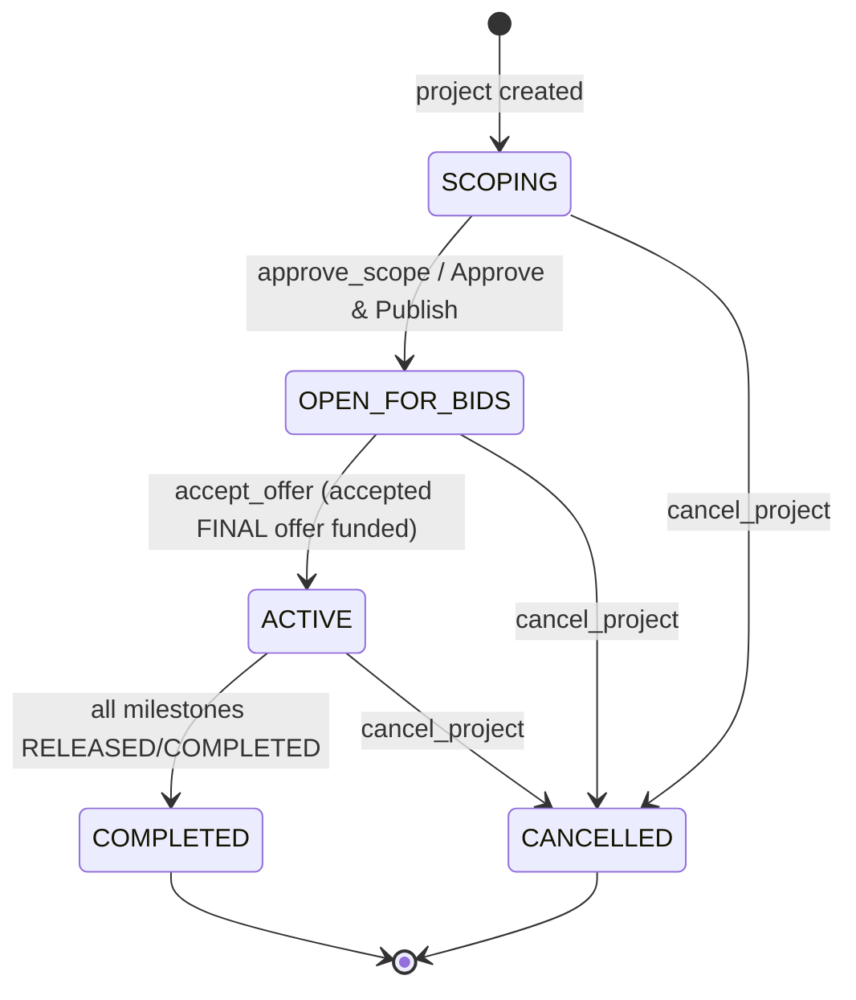

## 7. Socket.io Event Flow

### 7.1 Event Summary

| Event | Direction | Required payload | Ack | Side effects | Broadcasts |
|---|---|---|---|---|---|
| `join_project` | C→S | `{ projectId, userId? }` | — | Joins room; loads project (+ milestones, offers/selection as applicable); replays history | `project_updated`, `message_history`, `offers_updated` (to caller/room as applicable) |
| `send_message` | C→S | `{ projectId, content, senderId?, type?, payload? }` | `{ ok, message }` | Inserts `Message`; scope trigger special-case. **Pre-funding composer allowed only for client + selected builder during offer negotiation; always allowed when `ACTIVE` (and subject to role/room rules).** | `new_message` (room) |
| `approve_scope` | C→S | `{ projectId, userId?, payload?, messageId? }` | `{ ok, project }` | **Approve & Publish:** server normalizes scope/milestones/total (0/30/40/30), persists blueprint, sets `OPEN_FOR_BIDS` (open for offers) | `message_updated` (scope), `project_updated`, `new_message` |
| `submit_offer` | C→S | `{ projectId, builderId, totalCents, longTermAmountCents?, longTermCadence?, longTermNotes?, milestoneDueDates? }` | `{ ok, offer }` | Creates builder’s **single** `SUBMITTED` offer (auto-calc milestones snapshot). Rejected if builder already has **3 accepted/active (`ACTIVE`) projects**. | `offers_updated`, `new_message` (offer widget/system) |
| `revise_offer` | C→S | `{ offerId|projectId, builderId, ...terms }` | `{ ok, offer }` | Updates terms on builder’s offer when allowed (`SUBMITTED`; or post-cancel reverted state per rules) | `offers_updated`, `new_message` |
| `withdraw_offer` | C→S | `{ offerId|projectId, builderId }` | `{ ok, offer }` | Sets offer `WITHDRAWN` (final for project in MVP) when allowed | `offers_updated`, `new_message` |
| `select_offer` | C→S | `{ projectId, offerId, clientId }` | `{ ok, project, offer }` | Sets project selection; chosen offer `SELECTED`, other non-terminal offers `BLOCKED` | `offers_updated`, `project_updated`, `new_message` |
| `update_offer_terms` | C→S | `{ projectId, offerId, actorId, totalCents?, longTerm*, milestoneDueDates? }` | `{ ok, offer }` | Negotiation term edits (total→recalc, long-term costs, due dates) for selected/negotiating parties per rules | `offers_updated`, `new_message` |
| `mark_offer_final` | C→S | `{ projectId, offerId, builderId }` | `{ ok, offer }` | Builder marks selected offer `FINAL` (terms ready for decision) | `offers_updated`, `new_message` |
| `cancel_negotiation` | C→S | `{ projectId, clientId }` | `{ ok, project }` | Clears selection; selected offer reverts to `SUBMITTED` retaining terms; blocked offers reopen (choosable) | `offers_updated`, `project_updated`, `new_message` |
| `accept_offer` | C→S | `{ projectId, offerId, clientId }` | `{ ok, project, payment, clientSecret, offer }` | Accepts **final** offer: applies agreed terms/due dates to project+milestones, assigns builder, rejects other offers, funds escrow | `offers_updated`, `project_updated`, `new_message` |
| `submit_demo` | C→S | `{ projectId, milestoneId, demoUrl?, senderId?, payload? }` | `{ ok, message, latePenalty, overdueRevision? }` | Submits/resubmits demo for a milestone (Initial/Final Demo review scope). Applies due-date late penalty as today; sets `demoUrl` and review/pending state, records current demo submission, inserts `DEMO_WIDGET`. For **changes-requested** resubmissions targets the same milestone; soft 24h revision window is non-blocking but resubmission after target is flagged (audit/state). | `new_message`, `milestone_updated`, `project_updated` (as applicable) |
| `reject_demo` | C→S | `{ projectId, milestoneId, reason, userId? }` | `{ ok, milestone }` | Client-only (project owner) for **Initial/Final Demo** current submissions. Requires reason; sets `CHANGES_REQUESTED` with `revisionRequestedAt` (resets per rejection) and `revisionReason`; does **not** release funds. Emits audit `SYSTEM` message. | `new_message`, `milestone_updated`, `project_updated` |
| `approve_milestone` | C→S | `{ milestoneId, userId? }` | `{ ok, milestone }` | Client-only; approves/releases the **current, non-rejected** reviewable demo submission. Releases via escrow: $0 Agreement releases without transfer; positive milestones transfer funds. Sets `RELEASED` + `releasedAt`; may complete project. Guarded to reject approval when changes are requested or submission is not current. | `milestone_updated`, possibly `project_updated` |
| `cancel_project` | C→S | `{ projectId, userId? }` | `{ ok, project, refundPercent, refundAmount }` | Computes refund tier; sets `CANCELLED`, refund fields; inserts `SYSTEM` message | `project_updated`, `new_message` |
| `request_extension` | C→S | `{ projectId, userId? }` | `{ ok, project }` | Adds 48h to deadline (or now); sets `extensionRequested` (post-acceptance/`ACTIVE` flow) | `project_updated` |
| `submit_rating` | C→S | `{ projectId, rating 1–5, feedback?, userId? }` | `{ ok, project }` | Validates completed/cancelled; stores score/feedback | `project_updated`, `new_message` |
| `submit_onboarding` | C→S | `{ userId, ecosystems[], portfolioUrls[], rulesAccepted }` | `{ ok, user }` | Updates builder profile; clears `probationary` | — |
| `new_message` | S→C | Message record | — | — | room |
| `project_updated` | S→C | `{ project }` incl. milestones/selection context | — | — | room/caller |
| `offers_updated` | S→C | `{ projectId, offers, selectedOfferId }` | — | — | room/caller (visibility-filtered as needed) |
| `milestone_updated` | S→C | `{ milestone }` | — | — | room |

> **Compatibility:** legacy `claim` and prior single-`WIDGET` offer/fund flow are superseded by Offer events; `WIDGET` rendering may be derived from Offers during migration.

### 7.2 Project State Machine



> Offer selection/negotiation/finalization and negotiation-cancel occur while the project remains `OPEN_FOR_BIDS` (no funding). `accept_offer` applies agreed terms, assigns builder, rejects other offers, and funds escrow (mock activates; real Stripe may remain pending until funded). No exclusive first-claim step.

### 7.3 Primary Happy Path (sequence)

```mermaid
sequenceDiagram
    actor Client
    actor B1 as Builder A
    actor B2 as Builder B
    participant UI as React SPA
    participant S as Socket.io Server
    participant DB as PostgreSQL (Prisma)

    Client->>UI: Create plan, describe, refine with AI (SCOPE_WIDGET)
    Client->>UI: Edit/accept blueprint
    UI->>S: approve_scope (Approve & Publish)
    S->>DB: normalize scope/milestones, project → OPEN_FOR_BIDS
    S-->>UI: project_updated, new_message

    B1->>UI: Review published plan, submit initial offer
    UI->>S: submit_offer
    B2->>UI: Submit initial offer
    UI->>S: submit_offer
    S->>DB: create Offers (one per builder)
    S-->>UI: offers_updated

    Client->>UI: Compare offers, choose Builder A
    UI->>S: select_offer
    S->>DB: A=SELECTED, B=BLOCKED, project.selectedOfferId set
    S-->>UI: offers_updated, project_updated

    Note over Client,B1,UI: Negotiation (client + selected builder): chat + term edits
    Client->>UI: Discuss/adjust total, long-term costs, due dates
    UI->>S: send_message / update_offer_terms
    B1->>UI: Mark Final Offer
    UI->>S: mark_offer_final
    S-->>UI: offers_updated, new_message

    alt Client accepts final offer
        Client->>UI: Accept & Fund
        UI->>S: accept_offer(offerId)
        S->>DB: apply terms/due dates, assign builder, reject other offers, fund escrow
        S-->>UI: project_updated (ACTIVE), offers_updated, new_message
    else Client cancels negotiation
        Client->>UI: Cancel negotiation
        UI->>S: cancel_negotiation
        S->>DB: clear selection, A→SUBMITTED (terms kept), B unblocked
        S-->>UI: project_updated, offers_updated
    end

    Note over S,DB: Post-acceptance: demos, milestone approvals (0/30/40/30), completion
```

### 7.4 Handler Details

#### `join_project`
- Requires `projectId`; joins room.
- Emits `project_updated` (incl. milestones/selection context as applicable) and `message_history` to caller; emits `offers_updated` when offers are relevant.

#### `send_message`
- Requires `projectId` and `content`; scope trigger `[TRIGGER_SCOPE_GENERATION]` persists `SCOPE_WIDGET` (see §8).
- **Composer gating (server-enforced):** freeform `TEXT` messages allowed when project is `ACTIVE`, or when sender is the **client or selected builder** during an active negotiation/selection/final-decision window pre-funding; otherwise rejected (prevents premature/unscoped chat). System/widget emissions follow their specific handlers.

#### `approve_scope` (Approve & Publish)
- Requires `projectId`. Normalizes scope payload and project milestones/total to fixed 4 stages (0/30/40/30), persists blueprint/total, sets `OPEN_FOR_BIDS` (published/open for offers), emits `message_updated` (if applicable), `project_updated`, and `SYSTEM` message.

#### `submit_offer`
- Builder-only for an `OPEN_FOR_BIDS` project. Enforces **one active offer per builder** (`@@unique(projectId,builderId)` / equivalent) and the **accepted-active project limit**: builders with **3 `ACTIVE` projects** (`builderId` assigned, offers accepted) cannot submit offers on new project plans. Computes milestones snapshot from `totalCents` (0/30/40/30, read-only), stores long-term cost terms (informational) and proposed milestone due dates. Creates `SUBMITTED` offer; emits `offers_updated` (and offer widget/system message for compatibility).

#### `revise_offer`
- Builder-only, own offer. Allowed while offer is `SUBMITTED` (not selected/blocked/terminal), including after negotiation canceled and reverted to `SUBMITTED`. Updates terms (total→recalc, long-term costs, due dates) and emits `offers_updated`.

#### `withdraw_offer`
- Builder-only, own offer. Allowed while `SUBMITTED` (not selected/blocked). Sets `WITHDRAWN` (**final for that project in MVP**); emits `offers_updated`.

#### `select_offer`
- Client-only (project owner). Requires choosable `SUBMITTED` offer and no conflicting accepted state. Sets `project.selectedOfferId`, marks chosen offer `SELECTED`, marks other non-terminal offers `BLOCKED`; emits `offers_updated`, `project_updated`, `SYSTEM` message.

#### `update_offer_terms`
- Negotiation edits for selected/negotiating parties (client + selected builder) per rules: adjust `totalCents` (milestones recalculated), long-term costs, and milestone `dueDate`s on the offer. Emits `offers_updated`.

#### `mark_offer_final`
- Builder-only (selected builder). Marks selected offer `FINAL` with finalized timestamp; terms become the decision-ready snapshot. Emits `offers_updated`, `SYSTEM` message.

#### `cancel_negotiation`
- Client-only. Clears selection: previously selected offer reverts to `SUBMITTED` **retaining last terms**; `BLOCKED` offers return to `SUBMITTED` (choosable). Emits `offers_updated`, `project_updated`, `SYSTEM` message.

#### `accept_offer`
- Client-only. Requires specified offer to be `FINAL` (and selected) for the project.
- Applies agreed terms: set `project.totalEscrow`, sync project milestones (amounts 0/30/40/30, titles/order) and apply negotiated `dueDate`s; assign `project.builderId` from offer.
- Marks offer `ACCEPTED`, sets `project.acceptedOfferId`, marks other offers `REJECTED`.
- Calls `fundEscrow` (mock activates; real Stripe may return pending intent/client secret). Enforces probationary cap server-side.
- Emits `offers_updated`, `project_updated`, `SYSTEM`/message as applicable. Ack includes `{ project, offer, payment, clientSecret }`.

#### `submit_demo`
- Requires `projectId` and `milestoneId`. Applies existing due-date late penalty: `dueDate && now > dueDate ? round(amount * 0.05) : 0` (Agreement amount 0 → no penalty).
- Creates a new `DEMO_WIDGET` submission for the milestone and records it as the **current** demo (`demoUrl`/current submission ref). Sets pending/reviewable state (e.g. `IN_PROGRESS`) for a normal submission.
- **Resubmission (changes requested):** when the milestone is in `CHANGES_REQUESTED` (demo review scope: **Initial/Final Demo**), submission targets the **same milestone**, creates a new current `DEMO_WIDGET`, and transitions state back to reviewable; the **soft 24h revision window** (`revisionRequestedAt + 24h`, reset per rejection) does **not** block submission, but resubmission after the target is flagged as overdue in state/audit (and may be surfaced in ack/payload).
- Emits `new_message`, `milestone_updated` (and `project_updated` as applicable). Server must validate builder/ownership/eligibility per project rules.

#### `reject_demo`
- Requires `projectId`, `milestoneId`, and non-empty `reason`. **Client-only** (project owner), `ACTIVE` project, demo-review milestones (**Initial/Final Demo**) with a current reviewable submission.
- Does **not** release funds. Sets milestone to `CHANGES_REQUESTED`, records `revisionReason`, and sets/resets `revisionRequestedAt` (soft 24h target) for the **current** submission. Only the current submission is rejectable.
- Emits audit `SYSTEM` message (changes requested) plus `milestone_updated`/`project_updated` as applicable.

#### `approve_milestone`
- Requires `milestoneId`. **Client-only** (project owner). Approves/releases only the **current, non-rejected** reviewable demo submission; must reject if milestone is `CHANGES_REQUESTED` or submission is not current/actionable.
- Releases via escrow: amount 0 (Agreement) marked `RELEASED` without transfer; positive amounts transfer (mock auto-pay, real Stripe may stay pending). Clears/settles review state as appropriate, sets `RELEASED` + `releasedAt`; completes project when all milestones released/completed. Emits `milestone_updated` (+ `project_updated` on completion).

#### `submit_onboarding`
- Requires `userId`. Updates builder profile fields; sets `probationary: false`; no GitHub/portfolio verification.

#### `cancel_project`
- Computes refund tier by highest released stage (≥3→60%, ≥2→90%, else 100%), sets `CANCELLED` + refund fields, emits updates/system message.

#### `request_extension`
- Post-acceptance/`ACTIVE` flow: adds 48h to deadline (or now), sets `extensionRequested`; no approval flow (`extensionGranted` unused).

#### `submit_rating`
- Integer 1–5 after `COMPLETED` or `CANCELLED`; stores score/feedback and emits system message.

---

