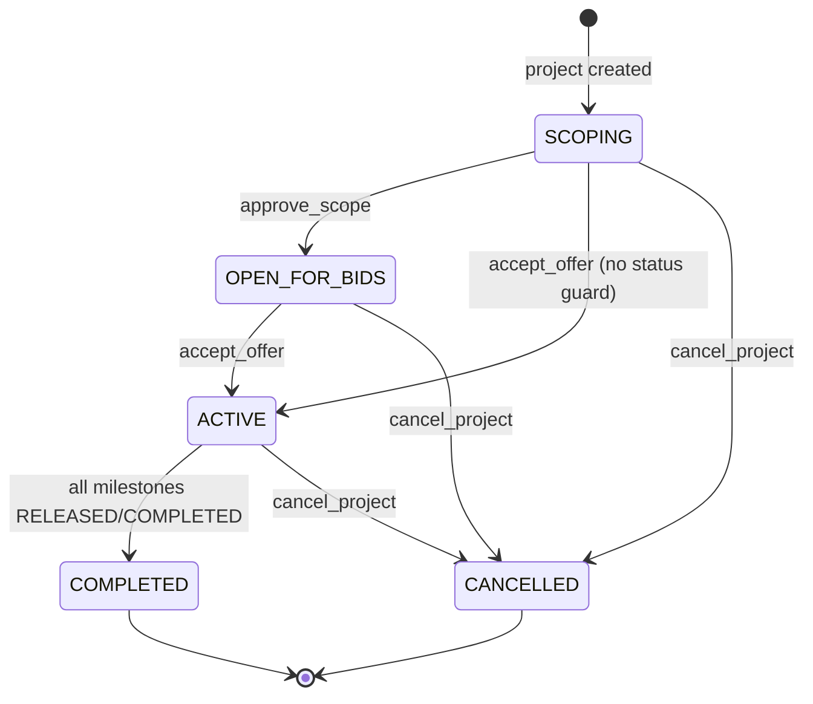

## 7. Socket.io Event Flow

### 7.1 Event Summary

| Event | Direction | Required payload | Ack | Side effects | Broadcasts |
|---|---|---|---|---|---|
| `join_project` | C→S | `{ projectId, userId? }` | — | Joins room; loads project + milestones | `project_updated` (to caller) |
| `send_message` | C→S | `{ projectId, content, senderId?, type?, payload? }` | `{ ok, message }` | Inserts `Message`; special-cases scope trigger | `new_message` (room) |
| `submit_demo` | C→S | `{ projectId, milestoneId, demoUrl?, senderId?, payload? }` | `{ ok, message, latePenalty }` | Applies late penalty; sets `demoUrl`, status `IN_PROGRESS`; inserts `DEMO_WIDGET` | `new_message`, `milestone_updated` |
| `approve_milestone` | C→S | `{ milestoneId }` | `{ ok, milestone }` | Sets `RELEASED` + `releasedAt`; may complete project | `milestone_updated`, possibly `project_updated` |
| `approve_scope` | C→S | `{ projectId, userId? }` | `{ ok, project }` | Sets `OPEN_FOR_BIDS`; inserts `SYSTEM` message | `project_updated`, `new_message` |
| `submit_onboarding` | C→S | `{ userId, ecosystems[], portfolioUrls[], rulesAccepted }` | `{ ok, user }` | Updates builder profile; clears `probationary` | — |
| `accept_offer` | C→S | `{ projectId }` | `{ ok, project }` | Sets `ACTIVE` | `project_updated` |
| `cancel_project` | C→S | `{ projectId, userId? }` | `{ ok, project, refundPercent, refundAmount }` | Computes refund tier; sets `CANCELLED`, `cancelledAt`, refund fields; inserts `SYSTEM` message | `project_updated`, `new_message` |
| `request_extension` | C→S | `{ projectId, userId? }` | `{ ok, project }` | Adds 48h to deadline (or now); sets `extensionRequested` | `project_updated` |
| `submit_rating` | C→S | `{ projectId, rating 1–5, feedback?, userId? }` | `{ ok, project }` | Validates completed/cancelled; stores score/feedback; inserts `SYSTEM` message | `project_updated`, `new_message` |
| `new_message` | S→C | Message record incl. sender | — | — | room |
| `project_updated` | S→C | `{ project }` incl. milestones | — | — | room (or caller) |
| `milestone_updated` | S→C | `{ milestone }` | — | — | room |

### 7.2 Project State Machine



> `accept_offer` does **not** check current status, so it can activate a project directly from `SCOPING` or `OPEN_FOR_BIDS`; it also does not set `totalEscrow` or milestone amounts. Escrow "funding" is currently a status transition only.

### 7.3 Primary Happy Path (sequence)

```mermaid
sequenceDiagram
    actor Client
    actor Builder
    participant UI as React SPA
    participant S as Socket.io Server
    participant DB as PostgreSQL (Prisma)

    Client->>UI: "Simulate AI Intake"
    UI->>S: send_message [TRIGGER_SCOPE_GENERATION]
    S->>DB: create SCOPE_WIDGET message (hardcoded blueprint)
    S-->>UI: new_message (room)
    Client->>UI: Approve Blueprint
    UI->>S: approve_scope
    S->>DB: Project → OPEN_FOR_BIDS + SYSTEM message
    S-->>UI: project_updated, new_message

    Builder->>UI: Generate Final Offer
    UI->>S: send_message (WIDGET payload milestones)
    S->>DB: create WIDGET message
    S-->>UI: new_message

    Client->>UI: Accept & Fund Escrow
    UI->>S: accept_offer
    S->>DB: Project → ACTIVE
    S-->>UI: project_updated

    Builder->>UI: Submit Next Demo
    UI->>S: submit_demo (milestoneId, demoUrl)
    S->>DB: penalty if late; milestone IN_PROGRESS; DEMO_WIDGET
    S-->>UI: new_message, milestone_updated

    Client->>UI: Approve Milestone
    UI->>S: approve_milestone
    S->>DB: milestone RELEASED/releasedAt
    S-->>UI: milestone_updated
    Note over S,DB: When all milestones released → Project COMPLETED
```

### 7.4 Handler Details

#### `join_project`
- Ignores payload without `projectId`.
- Joins the Socket.io room named `projectId`.
- Fetches project with `milestones`; if found, emits `project_updated` **only to the joining socket**.
- Does not fetch message history; chat history is not replayed on join (messages are in-memory on the client).

#### `send_message`
- Requires `projectId` and `content`; otherwise ack error.
- **Scope trigger:** if `content` contains the sentinel `[TRIGGER_SCOPE_GENERATION]`, creates a `SCOPE_WIDGET` message with a hardcoded blueprint payload (see §8) and returns.
- Otherwise creates a message with `type = data.type ?? "TEXT"` and optional JSON `payload`, including sender `{ id, name, image }`.
- Broadcasts `new_message` to the project room.

#### `submit_demo`
- Requires `projectId` and `milestoneId`.
- Loads milestone; computes late penalty:
  `latePenalty = milestone.dueDate && now > dueDate ? Math.round(milestone.amount * 0.05) : 0`
- If penalty > 0: sets milestone `latePenalty` and increments `project.latePenaltyTotal`.
- Updates milestone `demoUrl` and status `IN_PROGRESS`.
- Creates `DEMO_WIDGET` message with `{ milestoneId, demoUrl, latePenalty, ...data.payload }`.
- Emits `new_message`, then re-reads and emits `milestone_updated`.

#### `approve_milestone`
- Requires `milestoneId`.
- Sets status `RELEASED` and `releasedAt = now`.
- Loads all project milestones; if **every** milestone is `RELEASED` or `COMPLETED`, sets project `COMPLETED` and emits `project_updated`.
- Emits `milestone_updated`.
- Note: no authorization check that the caller is the project's client.

#### `approve_scope`
- Requires `projectId`.
- Sets project `OPEN_FOR_BIDS` (includes milestones).
- Creates `SYSTEM` message: `"Scope approved. Project is now open for bids."`
- Emits `project_updated` + `new_message`.

#### `submit_onboarding`
- Requires `userId`.
- Arrays are joined into comma-separated strings (`ecosystems`, `portfolioUrls`).
- Updates `ecosystems`, `portfolioUrls`, `rulesAccepted`, and sets `probationary: false`.
- No GitHub verification is stored despite the UI button.

#### `accept_offer`
- Requires `projectId`; sets status `ACTIVE`; returns project with milestones.
- Emits `project_updated`. No escrow amount validation or payment simulation.

#### `cancel_project`
- Requires `projectId`; loads project + milestones.
- Computes `maxReleasedStage` = highest `stageNumber` among `RELEASED`/`COMPLETED` milestones (0 if none).
- Refund tiers:
  - `maxReleasedStage >= 3` → **60%**
  - `maxReleasedStage >= 2` → **90%**
  - otherwise → **100%**
- `refundAmount = round(totalEscrow × refundPercent / 100)`.
- Sets `CANCELLED`, `cancelledAt`, `refundPercent`, `refundAmount`; creates `SYSTEM` message:
  `"Project cancelled. {refundPercent}% refund issued."`
- Emits `project_updated` + `new_message`.

#### `request_extension`
- Requires `projectId`.
- New deadline = `(project.deadline ?? now) + 48 hours`.
- Sets `extensionRequested: true` (and overwrites `deadline`).
- Emits `project_updated`.
- `extensionGranted` exists in schema but is never set; there is no client approval step.

#### `submit_rating`
- Requires `projectId`; rating must be an integer `1..5`.
- Only allowed when project status is `COMPLETED` or `CANCELLED`.
- Stores `qualityScore` and optional `qualityFeedback`; creates `SYSTEM` message:
  `"Quality rating submitted: {rating}/5."`
- Emits `project_updated` + `new_message`.
- Any connected user can rate; no check that the caller is the client.

---

